# AI Assisted Translations — How-To Guide

Get your content translated in seconds using AI directly inside Jahia — no copy-pasting, no switching tools.

---

## What does this module do?

Once installed and configured by your administrator, this module adds an **AI translation button** throughout jContent. With a single click you can:

- Translate an individual content item while editing it.
- Translate a full page (and everything on it) from the page header.

Translations can be previewed before saving, or applied directly to the content.

---

## Translating a content item

### From the Edit screen

Use this when you already have a content item open in the **Content Editor**.

1. Open the content item you want to translate.
2. Click the **three-dot menu** (⋯) in the top-right header toolbar.
3. Select **"Request AI translation"**.

   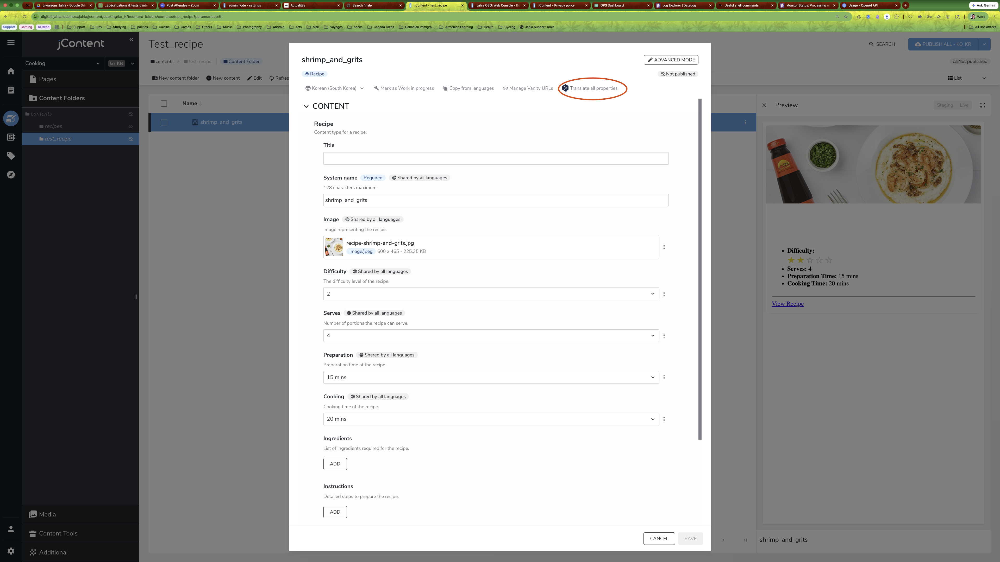

4. A dialog appears. The source language is pre-selected based on the side-by-side language visible in the editor.

   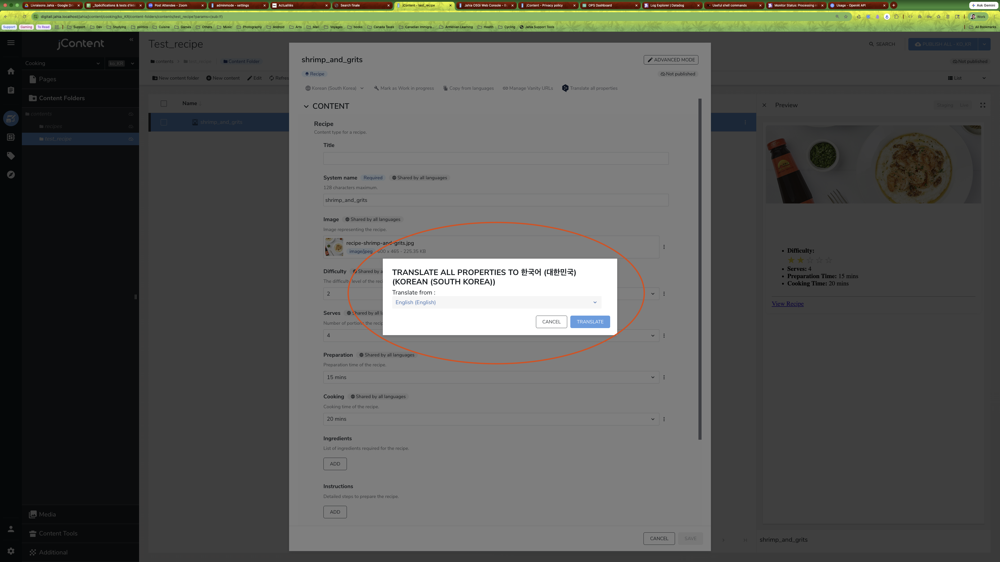

5. If you want to change the target language, use the language dropdown.

   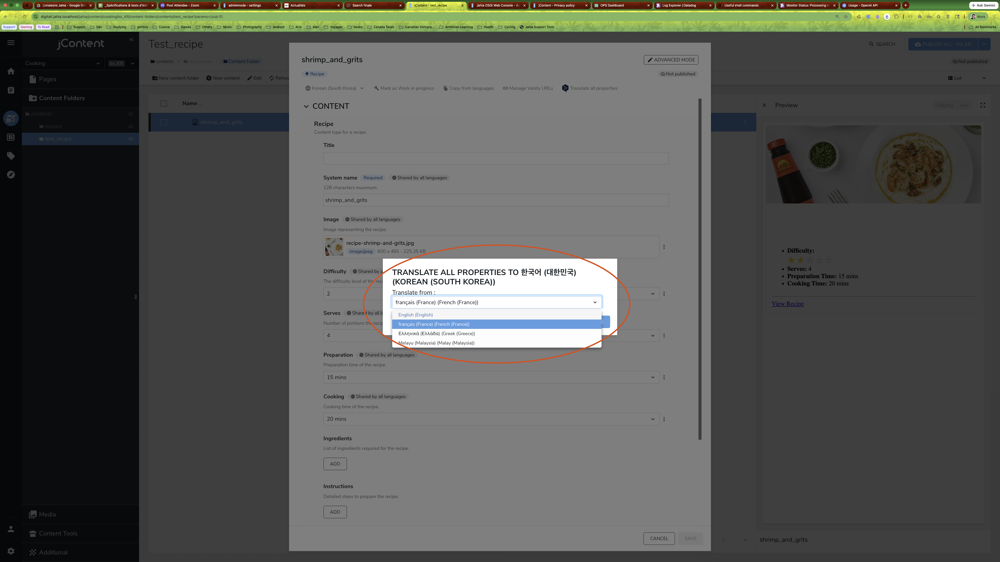

6. Click **Translate**. The translated values are injected into the form fields instantly — you can review and adjust them before saving.

   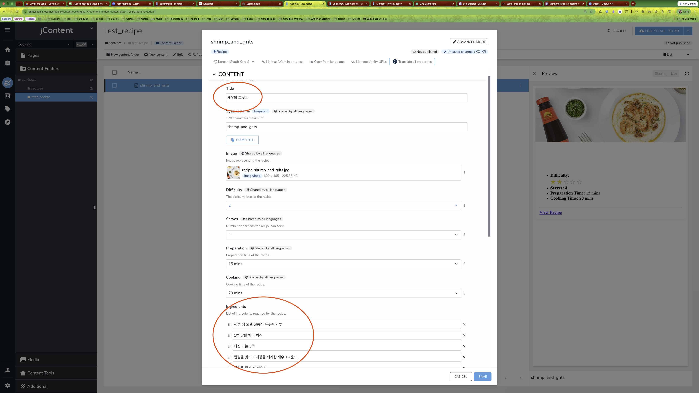

> **Tip:** Nothing is saved automatically. Review the suggestions and hit **Save** when you are happy with the result.

---

### From the Translate screen

Use this when you are in the dedicated **Translate** view of a content item (side-by-side languages).

1. In the Translate screen, click the **three-dot menu** (⋯) in the header toolbar.
2. Select **"Request AI translation"**.

   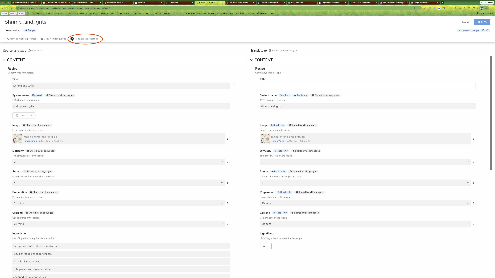

3. The dialog appears with the source language already set.

   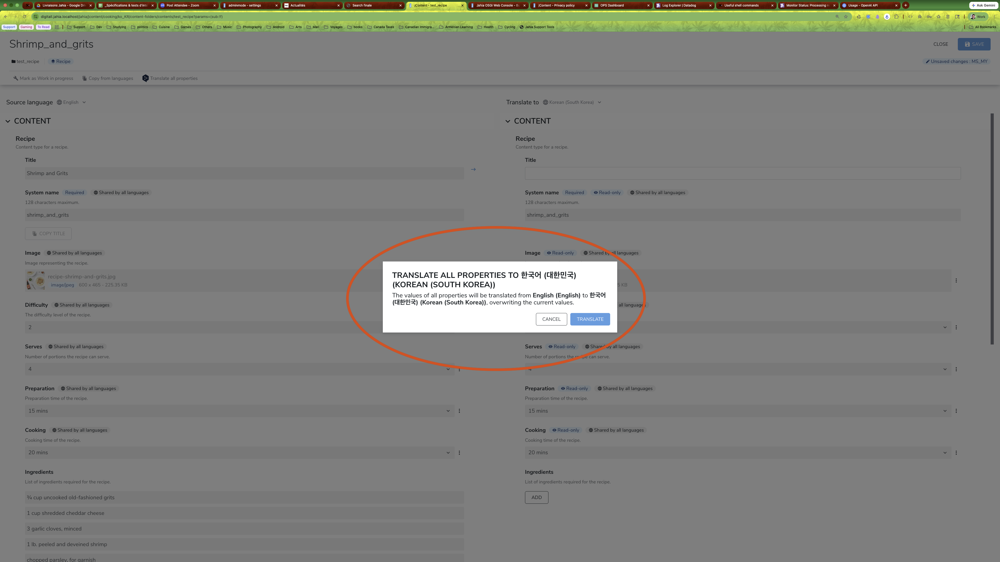

4. Click **Translate**. The translated fields are filled in on the target language side.

   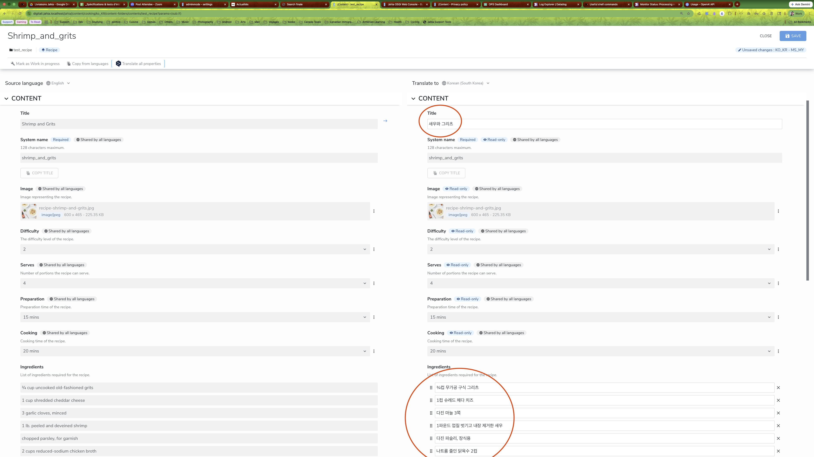

5. Review and **Save**.

---

## Translating a whole page

Use this to translate a page and all its content in one go, directly from the **page tree or page header**.

1. Navigate to the page you want to translate in jContent.
2. Click the **AI translation icon** in the primary action bar at the top of the page.

   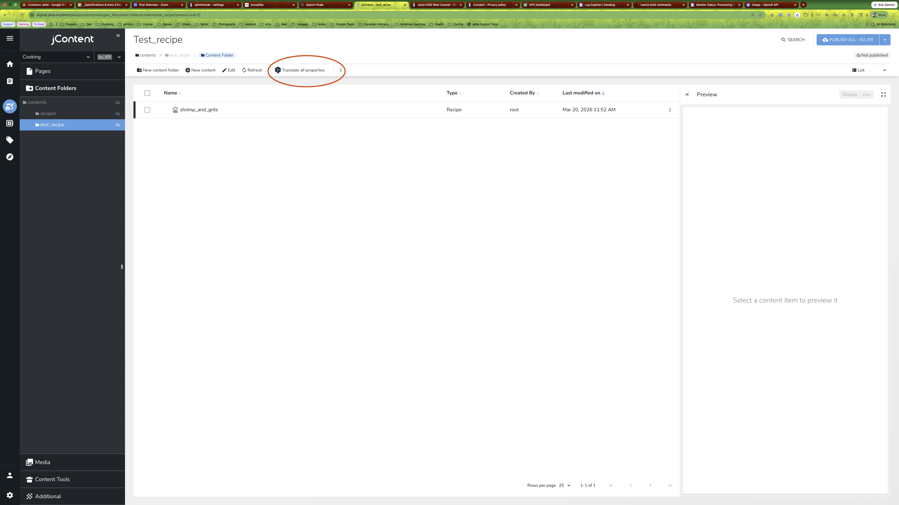

3. A dialog appears. Select the **source language** (the language your content is already written in).

   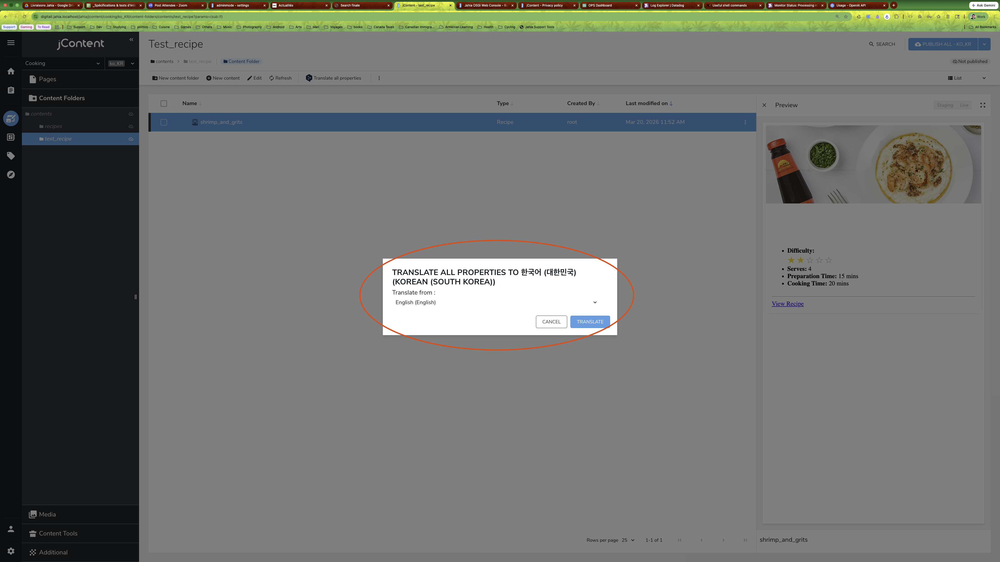

4. Use the language dropdown to pick a different source if needed.

   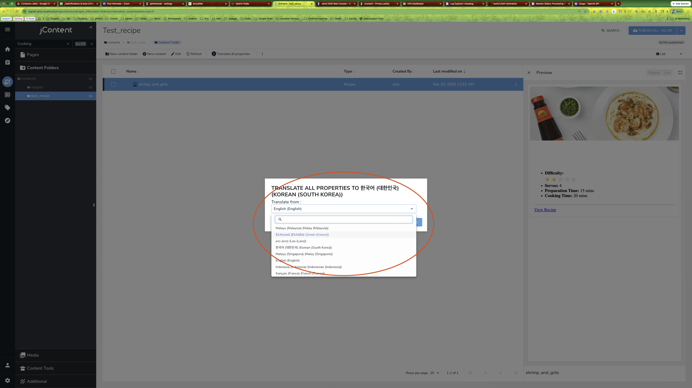

5. Click **Translate**. The module processes the page and all its translatable content into the target language.

   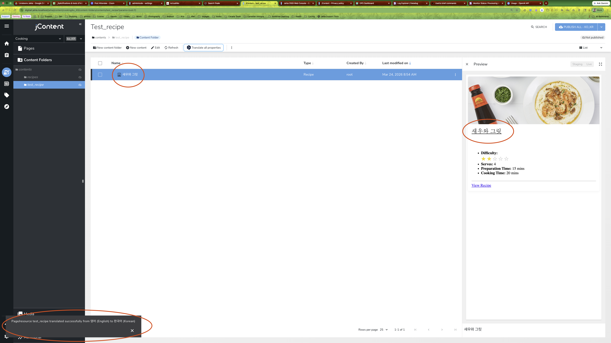

> **Note:** The target language is the language currently active in the editor UI. Switch the UI language first if you need to target a specific language.

---

## Using glossaries (terminology consistency)

Glossaries make sure brand names, product names, and specific terms are always translated the same way.

### What you need to do

1. Prepare a **CSV file** with your terminology. The file needs at minimum a `key` column and one column per language (e.g. `en`, `fr_FR`, `el_GR`).

   Example:

   | key | en | fr_FR | el_GR | ms_MY |
   |---|---|---|---|---|
   | oyster_sauce | Lee Kum Kee Oyster Sauce | Sauce aux huîtres Lee Kum Kee | Σαλτσα Στρειδιων Lee Kum Kee | Sos Tiram Lee Kum Kee |
   | stir_fry | stir-fry | sauter au wok | τηγανισμα στο γουοκ | tumis |

2. Upload the CSV file to your **site's glossary folder** in Jahia (your administrator can tell you the exact path — by default it is `/files/glossaries` under your site).

3. That's it. The next translation request will automatically pick up the glossary and apply it.

> **Tip:** You can have multiple CSV files in the glossary folder (one per topic, brand, or domain). They are all loaded and merged automatically.

---

## Frequently asked questions

**Do I have to configure anything?**
No — setup is handled by your Jahia administrator (API keys, provider selection, glossary folder path). You just use the buttons.

**Which AI provider is being used?**
DeepL, OpenAI, or a local Ollama model, depending on your organisation's configuration. The experience is the same from jContent regardless of the provider. Ollama runs on your own infrastructure, so content stays local.

**Can I translate into multiple languages at once?**
From the page-level action you can trigger one target language per run. Run the action again and switch the UI language to translate into additional languages.

**Will translation overwrite my existing content?**
For the **Edit / Translate screen** flow, suggested values are filled into the form but not saved until you click Save — you can discard any field you disagree with.
For the **page-level** flow, the translation is applied directly. Make sure to review the result afterwards.

**My glossary terms are not being applied — what should I check?**
- Make sure the CSV file is saved in the correct folder.
- Make sure the column headers match the language codes used by your site.
- Ask your administrator to verify the glossary folder path in the module configuration.

